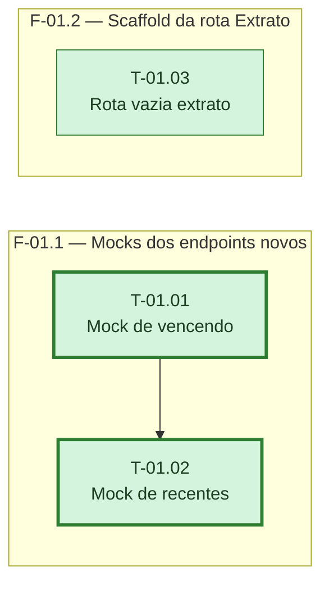

# Fases — Sprint 01

> Um bloco por fase. O paralelismo declarado aqui é definitivo: a execução nunca decide
> paralelismo sozinha.

---

## F-01.1 — Mocks dos endpoints novos

**Objetivo:** Estender o cliente fake de testes para responder aos dois endpoints que a feature
ainda vai criar no backend.

**Tasks que a compõem:** T-01.01, T-01.02

**Critério de saída:** `api-client-mocks.test.ts` cobre os dois caminhos novos com fixtures
configuráveis.

**Roda em paralelo com:** nenhuma

---

## F-01.2 — Scaffold da rota Extrato

**Objetivo:** Registrar a rota `/extrato` no roteador com um componente mínimo, para que
testes de navegação e dos componentes futuros tenham onde montar.

**Tasks que a compõem:** T-01.03

**Critério de saída:** `extrato.test.tsx` confirma que a rota renderiza sem erro.

**Roda em paralelo com:** F-01.1
