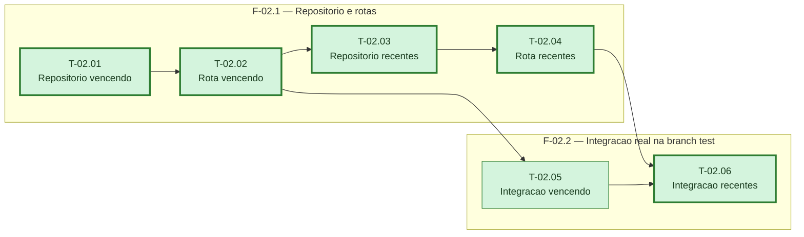

# Fases — Sprint 02

> Um bloco por fase. O paralelismo declarado aqui é definitivo.

---

## F-02.1 — Repositório e rotas

**Objetivo:** Implementar `listarVencendo`/`listarRecentes` no repositório de lançamentos e as
rotas `GET /lancamentos/vencendo` e `GET /lancamentos/recentes` que os expõem.

**Tasks que a compõem:** T-02.01, T-02.02, T-02.03, T-02.04

**Critério de saída:** `lancamentos.test.ts` cobre os dois repositórios e as duas rotas,
incluindo isolamento por `userId` e validação de parâmetros.

**Roda em paralelo com:** nenhuma

---

## F-02.2 — Integração real na branch test

**Objetivo:** Provar os dois endpoints contra o Postgres real da branch `test`, atrás de
`garantirBranchDeTeste()`.

**Tasks que a compõem:** T-02.05, T-02.06

**Critério de saída:** `npm run test:integration:lancamentos` passa cobrindo os dois endpoints.

**Roda em paralelo com:** nenhuma
