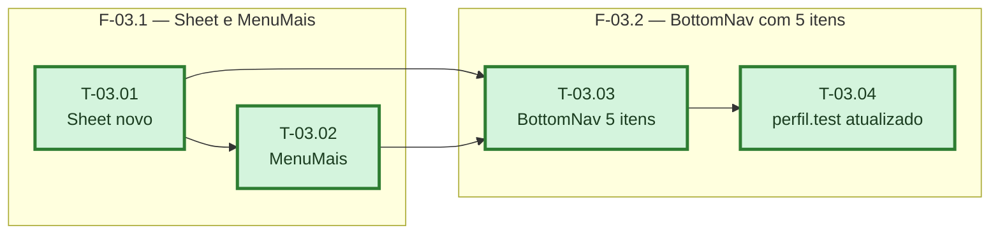

# Fases — Sprint 03

> Um bloco por fase. O paralelismo declarado aqui é definitivo.

---

## F-03.1 — Sheet e MenuMais

**Objetivo:** Construir o primitivo de gaveta lateral (`Sheet`) e o componente `MenuMais` com os
links de navegação e a ação de sair.

**Tasks que a compõem:** T-03.01, T-03.02

**Critério de saída:** `sheet.test.tsx` cobre abrir/fechar; `menu-mais.test.tsx` cobre navegação
e logout direto.

**Roda em paralelo com:** nenhuma

---

## F-03.2 — BottomNav com 5 itens

**Objetivo:** Plugar o `MenuMais` no `BottomNav`, atualizando a barra para 5 itens e corrigindo
o teste de `/perfil` que hoje espera `Perfil` na barra inferior.

**Tasks que a compõem:** T-03.03, T-03.04

**Critério de saída:** `bottom-nav.test.tsx` e `perfil.test.tsx` passam com a navegação nova.

**Roda em paralelo com:** nenhuma
