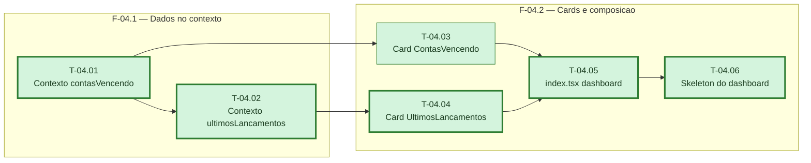

# Fases — Sprint 04

> Um bloco por fase. O paralelismo declarado aqui é definitivo.

---

## F-04.1 — Dados no contexto

**Objetivo:** Dar a `LancamentosProvider` o estado e os métodos de carregamento das duas listas
novas do dashboard, chamando os endpoints da sprint-02.

**Tasks que a compõem:** T-04.01, T-04.02

**Critério de saída:** `lancamentos-context.test.tsx` cobre os dois novos pares
estado/carregamento, incluindo erro seguindo `mensagemErroApi`.

**Roda em paralelo com:** nenhuma

---

## F-04.2 — Cards e composição

**Objetivo:** Criar os dois cards de conteúdo e recompor `index.tsx` como dashboard, com
skeleton próprio.

**Tasks que a compõem:** T-04.03, T-04.04, T-04.05, T-04.06

**Critério de saída:** `index.test.tsx` cobre os dois cards, o "ver mais" de cada um, e a
ausência de FAB/filtros na tela.

**Roda em paralelo com:** nenhuma
