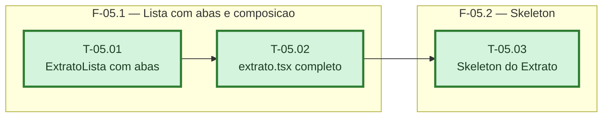

# Fases — Sprint 05

> Um bloco por fase. O paralelismo declarado aqui é definitivo.

---

## F-05.1 — Lista com abas e composição

**Objetivo:** Criar o componente de lista com abas e compor `extrato.tsx` com busca, mês,
abas e FAB.

**Tasks que a compõem:** T-05.01, T-05.02

**Critério de saída:** `extrato.test.tsx` cobre busca, navegação de mês, alternância de abas e
abertura do modal de registrar.

**Roda em paralelo com:** nenhuma

---

## F-05.2 — Skeleton

**Objetivo:** Dar ao Extrato um skeleton fiel ao layout novo (busca + mês + abas + lista),
seguindo o mesmo padrão já usado para Caixinhas e para o dashboard.

**Tasks que a compõem:** T-05.03

**Critério de saída:** O skeleton aparece só na primeira carga sem dados, igual ao padrão
já estabelecido no projeto.

**Roda em paralelo com:** nenhuma
