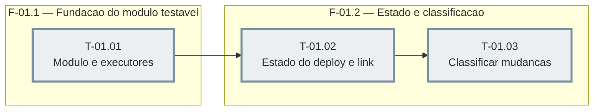

# Fases — Sprint 01

## F-01.1 — Fundação do módulo testável

**Objetivo:** Criar `scripts/deploy.mjs` com esqueleto, guard de main e executores (git via
spawn, neon via ComSpec, prompt, fetch) injetáveis, mais `scripts/deploy.test.ts` com harness
de executores falsos e diretório temporário.

**Tasks que a compõem:** T-01.01

**Critério de saída:** O módulo importa no vitest sem disparar o fluxo e o executor git real
roda `git branch --show-current` num repositório temporário.

**Roda em paralelo com:** nenhuma

---

## F-01.2 — Estado e classificação

**Objetivo:** Ler o estado de deploy (`.deploy-state.json`) e o link do CLI (`.neon`), e
classificar mudanças (Function, migrations, tree suja, branch errada, commits a pushar) a
partir das linhas do git.

**Tasks que a compõem:** T-01.02, T-01.03

**Critério de saída:** Estado e link lidos de arquivos reais em diretório temporário e
mudanças classificadas corretamente, com a suíte verde.

**Roda em paralelo com:** nenhuma
