```mermaid
%% Grafo de tasks — sprint-02 — gerado pela sprintx a partir de tasks.md
flowchart LR
  subgraph fase_02_1["F-02.1 — Orquestracao e gates"]
    T_02_01["T-02.01<br/>Orquestracao e dry-run"]
    T_02_02["T-02.02<br/>Gate de migration"]
    T_02_03["T-02.03<br/>Confirmacao da Function"]
  end
  subgraph fase_02_2["F-02.2 — Passos reais e entrada"]
    T_02_04["T-02.04<br/>Spawn npx neon deploy"]
    T_02_05["T-02.05<br/>Spawn git push e aviso do Pages"]
    T_02_06["T-02.06<br/>Health check com retry"]
    T_02_07["T-02.07<br/>Entrada e DEPLOY.md"]
  end
  T_02_01 --> T_02_02
  T_02_02 --> T_02_03
  T_02_03 --> T_02_04
  T_02_04 --> T_02_06
  T_02_06 --> T_02_05
  T_02_05 --> T_02_07

  classDef concluida fill:#d4f4dd,stroke:#2e7d32,color:#1b3d20
  classDef andamento fill:#fff3cd,stroke:#b8860b,color:#4a3800
  classDef bloqueada fill:#f8d7da,stroke:#c62828,color:#4a1d1f
  classDef pendente  fill:#eceff1,stroke:#78909c,color:#263238
  classDef critico   stroke-width:3px

  class T_02_01 pendente
  class T_02_02 pendente
  class T_02_03 pendente
  class T_02_04 pendente
  class T_02_05 pendente
  class T_02_06 pendente
  class T_02_07 pendente
  class T_02_01,T_02_02,T_02_03,T_02_04,T_02_05,T_02_06,T_02_07 critico
```

# Fases — Sprint 02

## F-02.1 — Orquestração e gates

**Objetivo:** Rodar a sequência inteira (checagens → gate de migration → confirmação da
Function → deploy → health check → push) com modo `--sim`, estado ausente fail-closed, ramo de
"nada a fazer" e gates que abortam antes de qualquer ação.

**Tasks que a compõem:** T-02.01, T-02.02, T-02.03

**Critério de saída:** Com executores falsos, os passos são chamados na ordem nas quatro
células da matriz `functionMudou × commitsAPushar`; dry-run não chama nenhum executor de ação;
estado ausente dispara Function e migration pendentes; branch errada ou link fora de
`production` aborta com exitCode 1.

**Roda em paralelo com:** nenhuma

---

## F-02.2 — Passos reais e entrada

**Objetivo:** Executar `npx neon deploy --env` (com validação de `FUNCTION_ALLOWED_ORIGINS` e
gravação do SHA), health check com retry, só então `git push` com aviso do Pages, e publicar a
entrada `npm run deploy` com o `DEPLOY.md`.

**Tasks que a compõem:** T-02.04, T-02.05, T-02.06, T-02.07

**Critério de saída:** `npx neon deploy` com env válido grava o SHA, o health check passa com
200 antes do push, o push real empurra para origin bare local e `npm run deploy` com o
`DEPLOY.md` (incluindo migration em production) estão publicados.

**Roda em paralelo com:** nenhuma
