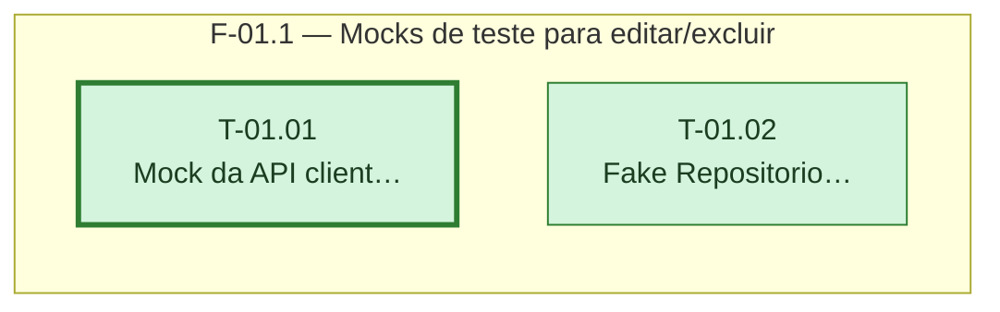

# Fases — Sprint 01

> Um bloco por fase. O paralelismo declarado aqui é definitivo: a execução nunca decide paralelismo sozinha.

---

## F-01.1 — Mocks de teste para editar/excluir

**Objetivo:** Dar às sprints seguintes mocks de PATCH/DELETE de lançamentos e um repositório fake que simula editar/excluir.

**Tasks que a compõem:** T-01.01, T-01.02

**Critério de saída:** Mock de API e repositório fake respondem editar/excluir, incluindo o bloqueio de vínculo com caixinha.

**Roda em paralelo com:** nenhuma
