# Fases — Sprint 02

```mermaid
%% Grafo de tasks — sprint-02 — gerado pela sprintx a partir de tasks.md
flowchart LR
  subgraph fase_02_1["F-02.1 — Leitura de apoio"]
    T_02_01["T-02.01<br/>Repositorio ganha…"]
  end
  subgraph fase_02_2["F-02.2 — Editar lancamento"]
    T_02_02["T-02.02<br/>Schema zod de…"]
    T_02_03["T-02.03<br/>Repositorio.editar…"]
    T_02_04["T-02.04<br/>Rota PATCH…"]
  end
  subgraph fase_02_3["F-02.3 — Excluir lancamento"]
    T_02_05["T-02.05<br/>Repositorio.excluir…"]
    T_02_06["T-02.06<br/>Rota DELETE…"]
  end
  T_02_01 --> T_02_02
  T_02_02 --> T_02_03
  T_02_03 --> T_02_04
  T_02_04 --> T_02_05
  T_02_05 --> T_02_06

  classDef concluida fill:#d4f4dd,stroke:#2e7d32,color:#1b3d20
  classDef andamento fill:#fff3cd,stroke:#b8860b,color:#4a3800
  classDef bloqueada fill:#f8d7da,stroke:#c62828,color:#4a1d1f
  classDef pendente  fill:#eceff1,stroke:#78909c,color:#263238
  classDef critico   stroke-width:3px

  class T_02_01 concluida
  class T_02_02 concluida
  class T_02_03 concluida
  class T_02_04 concluida
  class T_02_05 concluida
  class T_02_06 concluida
  class T_02_01,T_02_02,T_02_03,T_02_04,T_02_05,T_02_06 critico
```

> Um bloco por fase. O paralelismo declarado aqui é definitivo: a execução nunca decide paralelismo sozinha. As três fases encadeiam porque todas as tasks alteram os mesmos dois arquivos (`lancamentos.ts`, `lancamentos.test.ts`) — paralelismo real exigiria separar essas responsabilidades em módulos distintos, o que não se justifica pelo tamanho da feature.

---

## F-02.1 — Leitura de apoio

**Objetivo:** Dar ao repositório a leitura necessária para checar o vínculo com caixinha antes de editar/excluir.

**Tasks que a compõem:** T-02.01

**Critério de saída:** repositório expõe `buscarPorId` e `estaVinculadoACaixinha`.

**Roda em paralelo com:** nenhuma

---

## F-02.2 — Editar lançamento

**Objetivo:** Validar e persistir a edição de um lançamento, com suporte a propagar para parcelas futuras.

**Tasks que a compõem:** T-02.02, T-02.03, T-02.04

**Critério de saída:** `PATCH /lancamentos/:id` edita 1 parcela ou as futuras, bloqueia vínculo de caixinha e usa idempotência.

**Roda em paralelo com:** nenhuma

---

## F-02.3 — Excluir lançamento

**Objetivo:** Persistir a exclusão de um lançamento, mantendo `totalParcelas` consistente no grupo.

**Tasks que a compõem:** T-02.05, T-02.06

**Critério de saída:** `DELETE /lancamentos/:id` exclui 1 parcela ou as futuras, corrige `totalParcelas`, bloqueia vínculo de caixinha e usa idempotência.

**Roda em paralelo com:** nenhuma
