# Fases — Sprint 03

```mermaid
%% Grafo de tasks — sprint-03 — gerado pela sprintx a partir de tasks.md
flowchart LR
  subgraph fase_03_1["F-03.1 — Estado otimista no contexto"]
    T_03_01["T-03.01<br/>Contexto ganha…"]
  end
  subgraph fase_03_2["F-03.2 — Dialogo de acoes"]
    T_03_02["T-03.02<br/>Novo AcoesLancamento…"]
    T_03_03["T-03.03<br/>Acao Editar mostra…"]
    T_03_04["T-03.04<br/>Acao Excluir mostra…"]
    T_03_05["T-03.05<br/>Pergunta de alcance…"]
    T_03_06["T-03.06<br/>Erro de vinculo com…"]
  end
  T_03_01 --> T_03_02
  T_03_02 --> T_03_03
  T_03_03 --> T_03_04
  T_03_04 --> T_03_05
  T_03_05 --> T_03_06

  classDef concluida fill:#d4f4dd,stroke:#2e7d32,color:#1b3d20
  classDef andamento fill:#fff3cd,stroke:#b8860b,color:#4a3800
  classDef bloqueada fill:#f8d7da,stroke:#c62828,color:#4a1d1f
  classDef pendente  fill:#eceff1,stroke:#78909c,color:#263238
  classDef critico   stroke-width:3px

  class T_03_01 concluida
  class T_03_02 concluida
  class T_03_03 concluida
  class T_03_04 concluida
  class T_03_05 concluida
  class T_03_06 concluida
  class T_03_01,T_03_02,T_03_03,T_03_04,T_03_05,T_03_06 critico
```

> Um bloco por fase. O paralelismo declarado aqui é definitivo: a execução nunca decide paralelismo sozinha. As tasks de F-03.2 encadeiam porque todas editam o mesmo componente novo (`acoes-lancamento-dialog.tsx`).

---

## F-03.1 — Estado otimista no contexto

**Objetivo:** Expor editar/excluir no `LancamentosProvider`, seguindo o padrão otimista já usado por `marcarComoPaga`.

**Tasks que a compõem:** T-03.01

**Critério de saída:** contexto expõe `editarReceita`, `editarDespesa` e `excluirLancamento`, otimistas com rollback.

**Roda em paralelo com:** nenhuma

---

## F-03.2 — Diálogo de ações

**Objetivo:** Construir o diálogo único que substitui `ConfirmarPagamentoDialog`, com as três ações e os tratamentos de parcela/caixinha.

**Tasks que a compõem:** T-03.02, T-03.03, T-03.04, T-03.05, T-03.06

**Critério de saída:** `AcoesLancamentoDialog` oferece marcar como paga, editar e excluir, com alcance de parcela e erro de vínculo de caixinha tratados.

**Roda em paralelo com:** nenhuma
