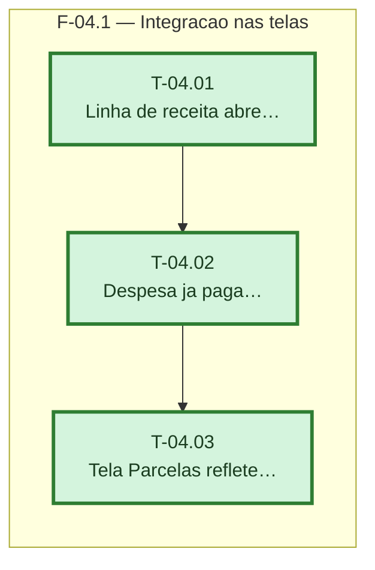

# Fases — Sprint 04

> Um bloco por fase. O paralelismo declarado aqui é definitivo: a execução nunca decide paralelismo sozinha. As três tasks encadeiam porque T-04.01 e T-04.02 editam os mesmos arquivos de tela.

---

## F-04.1 — Integração nas telas

**Objetivo:** Ligar o diálogo de ações às duas telas, cobrindo receita e despesa paga, e confirmar o reflexo na tela Parcelas.

**Tasks que a compõem:** T-04.01, T-04.02, T-04.03

**Critério de saída:** receita e despesa (paga ou não) abrem o diálogo de ações nas duas telas, e a tela Parcelas reflete edição/exclusão de parcela.

**Roda em paralelo com:** nenhuma
