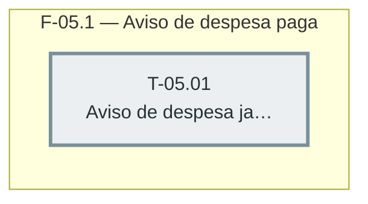

# Fases — Sprint 05

> Um bloco por fase. O paralelismo declarado aqui é definitivo: a execução nunca decide paralelismo sozinha.

---

## F-05.1 — Aviso de despesa paga

**Objetivo:** Avisar no diálogo que a despesa já foi paga e que a mudança afeta o Total Pago.

**Tasks que a compõem:** T-05.01

**Critério de saída:** `AcoesLancamentoDialog` avisa quando a despesa editada/excluída já foi paga.

**Roda em paralelo com:** nenhuma
