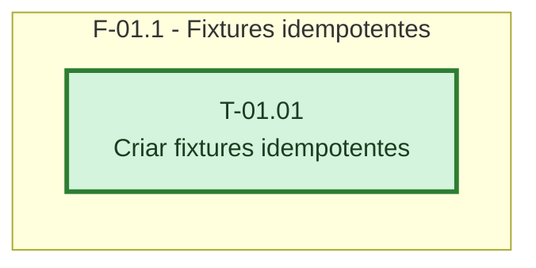

# Fases - Sprint 01

## F-01.1 - Fixtures idempotentes

**Objetivo:** Padronizar chaves e requisições repetidas para os testes unitários e de integração.

**Tasks que a compõem:** T-01.01

**Critério de saída:** O helper produz a mesma chave em repetições e payloads distintos para conflito.

**Roda em paralelo com:** nenhuma
