```mermaid
%% Grafo de tasks - sprint-02 - gerado pela sprintx a partir de tasks.md
flowchart LR
  subgraph fase_02_1["F-02.1 - Persistencia"]
    T_02_01["T-02.01<br/>Criar schema e migration"]
    T_02_02["T-02.02<br/>Criar executor transacional"]
  end
  subgraph fase_02_2["F-02.2 - API financeira"]
    T_02_03["T-02.03<br/>Proteger lancamentos"]
    T_02_04["T-02.04<br/>Proteger caixinhas"]
  end
  subgraph fase_02_3["F-02.3 - Cliente e integracao"]
    T_02_05["T-02.05<br/>Criar POST idempotente"]
    T_02_06["T-02.06<br/>Usar chave nos contextos"]
    T_02_07["T-02.07<br/>Validar no Neon test"]
  end
  T_02_01 --> T_02_02
  T_02_02 --> T_02_03
  T_02_03 --> T_02_04
  T_02_04 --> T_02_05
  T_02_05 --> T_02_06
  T_02_06 --> T_02_07

  classDef concluida fill:#d4f4dd,stroke:#2e7d32,color:#1b3d20
  classDef andamento fill:#fff3cd,stroke:#b8860b,color:#4a3800
  classDef bloqueada fill:#f8d7da,stroke:#c62828,color:#4a1d1f
  classDef pendente  fill:#eceff1,stroke:#78909c,color:#263238
  classDef critico   stroke-width:3px

  class T_02_01 concluida
  class T_02_02 concluida
  class T_02_03 concluida
  class T_02_04 concluida
  class T_02_05 concluida
  class T_02_06 concluida
  class T_02_07 concluida
  class T_02_01,T_02_02,T_02_03,T_02_04,T_02_05,T_02_06,T_02_07 critico
```

# Fases - Sprint 02

## F-02.1 - Persistência

**Objetivo:** Criar a tabela e o executor transacional que reserva e reproduz respostas.

**Tasks que a compõem:** T-02.01, T-02.02

**Critério de saída:** Schema, migration e executor passam em testes unitários e na branch de teste.

**Roda em paralelo com:** nenhuma

## F-02.2 - API financeira

**Objetivo:** Proteger lançamentos, depósitos e resgates com o mesmo contrato HTTP.

**Tasks que a compõem:** T-02.03, T-02.04

**Critério de saída:** Os três endpoints repetem respostas sem repetir mutações e rejeitam conflito com 409.

**Roda em paralelo com:** nenhuma

## F-02.3 - Cliente e integração

**Objetivo:** Enviar e reutilizar a chave no frontend e provar o comportamento no banco real de teste.

**Tasks que a compõem:** T-02.05, T-02.06, T-02.07

**Critério de saída:** O frontend envia a chave, repete apenas falhas transitórias e os testes reais passam.

**Roda em paralelo com:** nenhuma
