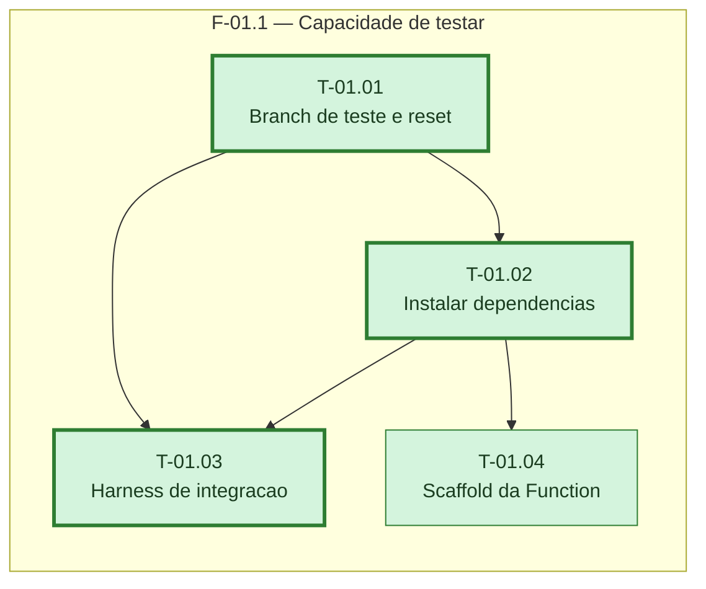

# Fases — Sprint 01

---

## F-01.1 — Capacidade de testar

**Objetivo:** Deixar a branch de teste, as dependências, o harness de integração e o scaffold
da Function prontos antes de qualquer sprint de negócio.

**Tasks que a compõem:** T-01.01, T-01.02, T-01.03, T-01.04

**Critério de saída:** `npm run test:integration` conecta na branch de teste e `GET /health`
responde 200 via `neon dev`.

**Roda em paralelo com:** nenhuma
