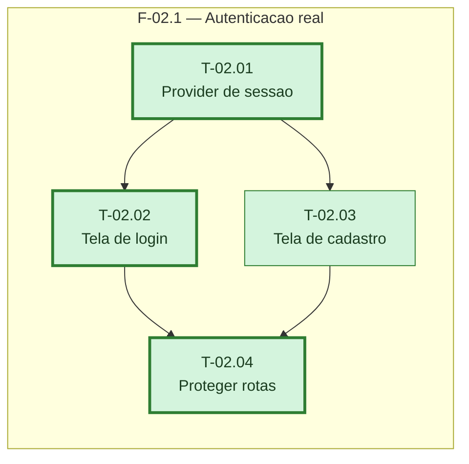

# Fases — Sprint 02

---

## F-02.1 — Autenticacao real

**Objetivo:** Login e cadastro reais via Neon Managed Auth, com rotas protegidas e o perfil
mockado removido.

**Tasks que a compõem:** T-02.01, T-02.02, T-02.03, T-02.04

**Critério de saída:** Login e cadastro autenticam contra a branch de teste e nenhuma tela
importa `src/lib/perfil-mock.ts`.

**Roda em paralelo com:** nenhuma
