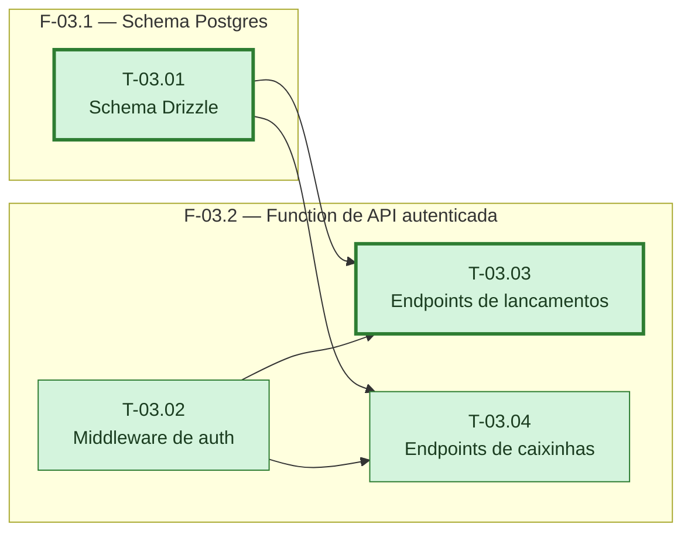

# Fases — Sprint 03

---

## F-03.1 — Schema Postgres

**Objetivo:** Aplicar o schema de lançamentos e caixinhas (uuid, centavos, `user_id`) na
branch de teste.

**Tasks que a compõem:** T-03.01

**Critério de saída:** Migration aplicada na branch de teste com as duas tabelas do contrato.

**Roda em paralelo com:** F-03.2 (T-03.02 não depende de T-03.01; T-03.03/T-03.04 esperam as duas)

---

## F-03.2 — Function de API autenticada

**Objetivo:** Expor lançamentos e caixinhas via Neon Function, autenticada por JWT e isolada
por `user_id`.

**Tasks que a compõem:** T-03.02, T-03.03, T-03.04

**Critério de saída:** Rotas de lançamentos e caixinhas exigem JWT válido e só retornam/alteram
linhas do usuário do token.

**Roda em paralelo com:** F-03.1 (T-03.02 não depende de T-03.01; T-03.03/T-03.04 esperam as duas)
