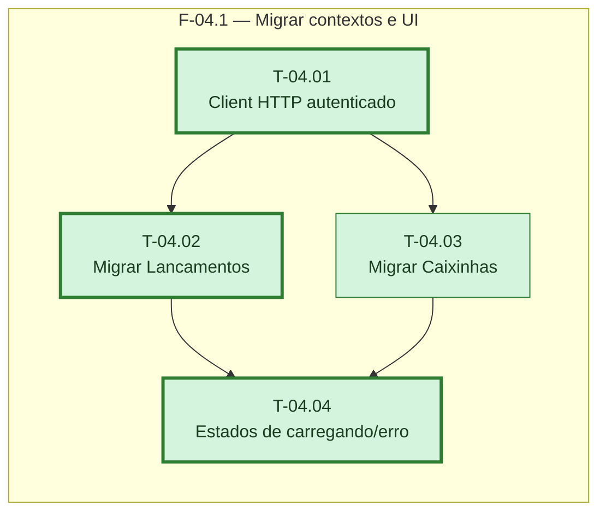

# Fases — Sprint 04

---

## F-04.1 — Migrar contextos e UI

**Objetivo:** Trocar `LancamentosProvider`/`CaixinhasProvider` pela Function real e acrescentar
os estados de carregando/erro/vazio/populado nas três telas de dados.

**Tasks que a compõem:** T-04.01, T-04.02, T-04.03, T-04.04

**Critério de saída:** Início, Parcelas e Caixinhas leem e escrevem na Function real,
sobrevivendo a reload, com os 4 estados de tela.

**Roda em paralelo com:** nenhuma
