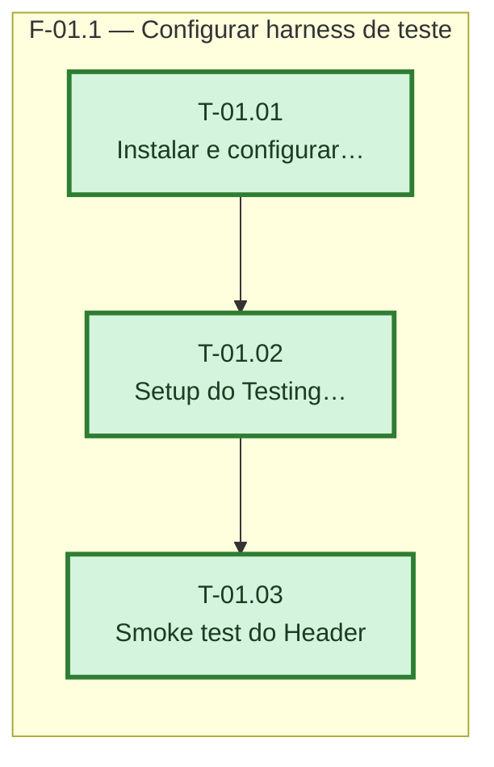

# Fases — Sprint 01

---

## F-01.1 — Configurar harness de teste

**Objetivo:** Instalar Vitest + Testing Library, configurar o ambiente jsdom e provar com um smoke test real que a suíte roda.

**Tasks que a compõem:** T-01.01, T-01.02, T-01.03

**Critério de saída:** `npm run test -- --run` termina com 0 failed e ao menos 1 passed.

**Roda em paralelo com:** nenhuma
