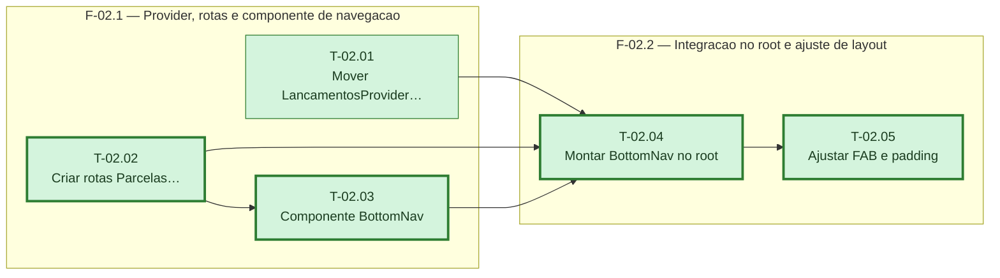

# Fases — Sprint 02

---

## F-02.1 — Provider, rotas e componente de navegação

**Objetivo:** Deixar prontas as três peças independentes que a integração da F-02.2 vai montar: o provider no root, as rotas novas, e o componente de navegação.

**Tasks que a compõem:** T-02.01, T-02.02, T-02.03

**Critério de saída:** `LancamentosProvider` funciona a partir do root, as 3 rotas novas resolvem sem erro, e `BottomNav` renderiza os 4 rótulos com o estado ativo correto quando testado isoladamente.

**Roda em paralelo com:** nenhuma

---

## F-02.2 — Integração no root e ajuste de layout

**Objetivo:** Montar o `BottomNav` no root para aparecer em todas as rotas, e ajustar o `RegistrarFab`/padding para não sobrepor a nova barra.

**Tasks que a compõem:** T-02.04, T-02.05

**Critério de saída:** `BottomNav` aparece em pelo menos duas rotas diferentes renderizadas, e o `RegistrarFab` tem posição ajustada para não colidir com a barra.

**Roda em paralelo com:** nenhuma
