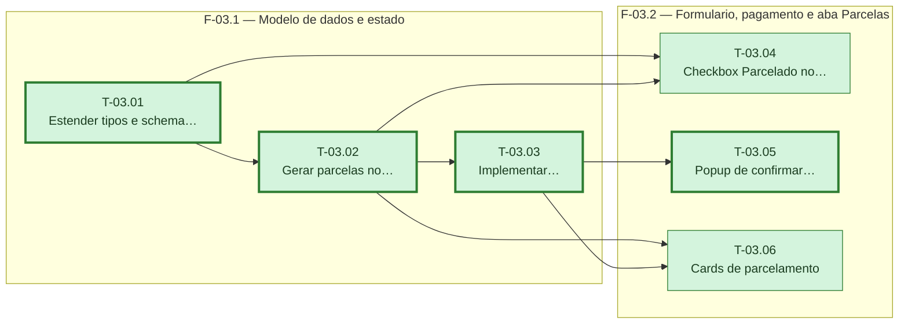

# Fases — Sprint 03

---

## F-03.1 — Modelo de dados e estado

**Objetivo:** Estender `Despesa` e o schema do formulário com os campos de parcelamento, gerar as parcelas no estado e implementar a marcação de pagamento.

**Tasks que a compõem:** T-03.01, T-03.02, T-03.03

**Critério de saída:** `adicionarDespesa` com `parcelado: true` gera as N despesas mensais corretas, e `marcarComoPaga` altera o campo `paga` da despesa certa.

**Roda em paralelo com:** nenhuma

---

## F-03.2 — Formulário, pagamento e aba Parcelas

**Objetivo:** Construir, em paralelo (nenhuma das três depende da outra, só da F-03.1 já concluída, e tocam arquivos distintos), o checkbox de parcelamento no formulário, o popup de marcar como paga, e os cards da aba Parcelas.

**Tasks que a compõem:** T-03.04, T-03.05, T-03.06

**Critério de saída:** Submeter o formulário parcelado gera as despesas corretas; clicar numa despesa na Início e confirmar chama `marcarComoPaga`; a rota `/parcelas` mostra um card por grupo de parcelamento com Pago/Falta e progresso.

**Roda em paralelo com:** nenhuma
