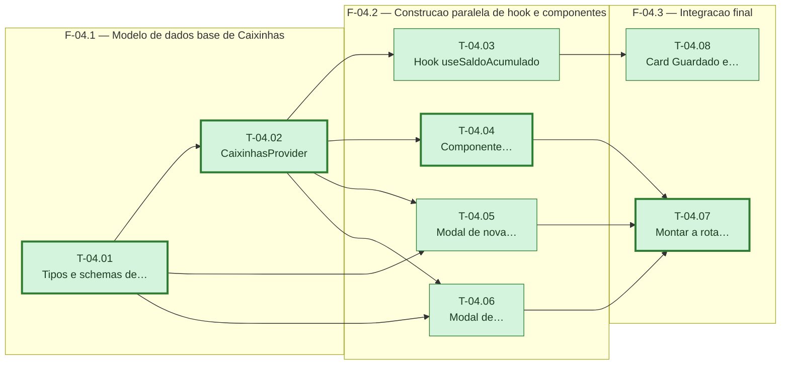

# Fases — Sprint 04

---

## F-04.1 — Modelo de dados base de Caixinhas

**Objetivo:** Criar o tipo `Caixinha`, os schemas zod e o `CaixinhasProvider` com as quatro ações.

**Tasks que a compõem:** T-04.01, T-04.02

**Critério de saída:** Criar, depositar, resgatar e excluir caixinha funcionam no estado, com `totalGuardado` derivado corretamente.

**Roda em paralelo com:** nenhuma

---

## F-04.2 — Construção paralela de hook e componentes

**Objetivo:** Construir, em paralelo (todas dependem só de T-04.02, já concluída, e tocam arquivos distintos), o hook de saldo combinado e os três componentes de UI de Caixinhas.

**Tasks que a compõem:** T-04.03, T-04.04, T-04.05, T-04.06

**Critério de saída:** `useSaldoAcumulado` reflete o total guardado; `CaixinhaCard`, o modal de criar e o modal de movimentar existem e funcionam isoladamente.

**Roda em paralelo com:** nenhuma

---

## F-04.3 — Integração final

**Objetivo:** Montar a rota `/caixinhas` de fato e atualizar a tela Início com o card "Guardado" e o saldo combinado — as duas tasks não dependem uma da outra e tocam arquivos distintos.

**Tasks que a compõem:** T-04.07, T-04.08

**Critério de saída:** A rota `/caixinhas` funciona de ponta a ponta, e a tela Início mostra 3 cards e o saldo acumulado considerando Caixinhas.

**Roda em paralelo com:** nenhuma
