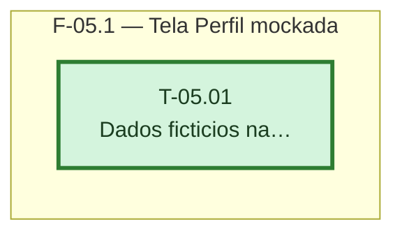

# Fases — Sprint 05

---

## F-05.1 — Tela Perfil mockada

**Objetivo:** Preencher a rota `/perfil` com nome e e-mail fictícios, somente leitura.

**Tasks que a compõem:** T-05.01

**Critério de saída:** A rota `/perfil` mostra o nome e o e-mail fictícios definidos no mock, sem nenhum campo editável.

**Roda em paralelo com:** nenhuma
