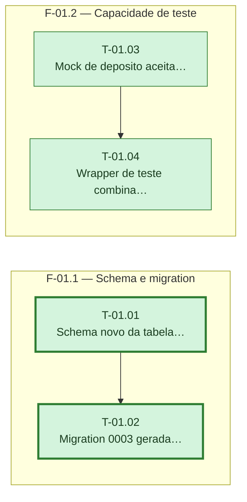

# Fases — Sprint 01

> `F-01.1` e `F-01.2` rodam em paralelo (arquivos independentes). Dentro de cada fase as tasks são
> sequenciais. Caminho crítico: `T-01.01 → T-01.02` (empate em comprimento com `T-01.03 →
> T-01.04`, desempatado pelo id menor).

---

## F-01.1 — Schema e migration

**Objetivo:** Declarar a tabela de movimentações e aplicá-la como migration validada na branch de teste.

**Tasks que a compõem:** T-01.01, T-01.02

**Critério de saída:** `npm run test:migrate` aplica a migration 0003 na branch `test` sem erro.

**Roda em paralelo com:** F-01.2

---

## F-01.2 — Capacidade de teste

**Objetivo:** Preparar os mocks e o wrapper de teste que as sprints seguintes vão precisar para TDD das regras de negócio.

**Tasks que a compõem:** T-01.03, T-01.04

**Critério de saída:** O mock de depósito propaga `origem` e o Wrapper combinado monta `CaixinhasProvider` + `LancamentosProvider` com estado compartilhado.

**Roda em paralelo com:** F-01.1
