# Fases — Sprint 02

```mermaid
%% Grafo de tasks — sprint-02 — gerado pela sprintx a partir de tasks.md
flowchart LR
  subgraph fase_02_1["F-02.1 — Helper compartilhado de…"]
    T_02_01["T-02.01<br/>Helper compartilhado…"]
  end
  subgraph fase_02_2["F-02.2 — Rotas de caixinhas com…"]
    T_02_02["T-02.02<br/>Deposito de_fora com…"]
    T_02_03["T-02.03<br/>Deposito de_fora sem…"]
    T_02_04["T-02.04<br/>Deposito saldo_atual…"]
    T_02_05["T-02.05<br/>Resgate grava linha…"]
  end
  subgraph fase_02_3["F-02.3 — Integracao real"]
    T_02_06["T-02.06<br/>Integracao real cobre…"]
  end
  T_02_01 --> T_02_02
  T_02_02 --> T_02_03
  T_02_03 --> T_02_04
  T_02_04 --> T_02_05
  T_02_05 --> T_02_06

  classDef concluida fill:#d4f4dd,stroke:#2e7d32,color:#1b3d20
  classDef andamento fill:#fff3cd,stroke:#b8860b,color:#4a3800
  classDef bloqueada fill:#f8d7da,stroke:#c62828,color:#4a1d1f
  classDef pendente  fill:#eceff1,stroke:#78909c,color:#263238
  classDef critico   stroke-width:3px

  class T_02_01 concluida
  class T_02_02 concluida
  class T_02_03 concluida
  class T_02_04 concluida
  class T_02_05 concluida
  class T_02_06 concluida
  class T_02_01,T_02_02,T_02_03,T_02_04,T_02_05,T_02_06 critico
```

> Sprint inteira é uma cadeia única (todas as tasks tocam `caixinhas.ts`/`caixinhas.test.ts` em
> sequência, exceto T-02.01 que é a base). Caminho crítico: a sprint inteira.

---

## F-02.1 — Helper compartilhado de lançamento

**Objetivo:** Extrair a criação de lançamento de receita num módulo que `caixinhas.ts` pode usar sem importar as rotas de `lancamentos.ts`.

**Tasks que a compõem:** T-02.01

**Critério de saída:** Teste próprio do helper passa isolado.

**Roda em paralelo com:** nenhuma

---

## F-02.2 — Rotas de caixinhas com origem

**Objetivo:** Implementar os quatro cenários de depósito/resgate (de_fora com e sem chave, saldo_atual, resgate com auditoria).

**Tasks que a compõem:** T-02.02, T-02.03, T-02.04, T-02.05

**Critério de saída:** `npm run test -- caixinhas.test.ts` cobre os quatro cenários e passa.

**Roda em paralelo com:** nenhuma

---

## F-02.3 — Integração real

**Objetivo:** Provar o comportamento contra o Postgres real da branch `test`, incluindo idempotência.

**Tasks que a compõem:** T-02.06

**Critério de saída:** `npm run test:integration:idempotencia` passa com o cenário `de_fora`.

**Roda em paralelo com:** nenhuma
