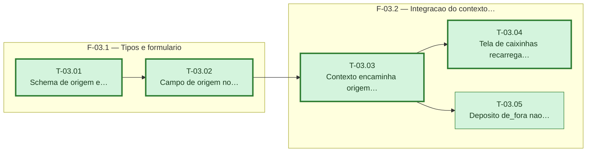

# Fases — Sprint 03

> `T-03.04` e `T-03.05` dependem só de `T-03.03` e não uma da outra — rodam em paralelo (arquivos
> distintos). Caminho crítico: `T-03.01 → T-03.02 → T-03.03 → T-03.04` (empate com `T-03.05`,
> desempatado pelo id menor).

---

## F-03.1 — Tipos e formulário

**Objetivo:** Dar ao usuário a escolha de origem no formulário de depósito, com validação e valor padrão corretos.

**Tasks que a compõem:** T-03.01, T-03.02

**Critério de saída:** `npm run test -- movimentar-caixinha-modal.test.tsx` passa cobrindo depósito e resgate.

**Roda em paralelo com:** nenhuma

---

## F-03.2 — Integração do contexto com saldo e lançamentos

**Objetivo:** Propagar a origem pelo contexto, recarregar o saldo do mês quando necessário, e provar o efeito líquido zero do caso `de_fora`.

**Tasks que a compõem:** T-03.03, T-03.04, T-03.05

**Critério de saída:** `npm run test -- caixinhas-context.test.tsx caixinhas.test.tsx use-saldo-acumulado.test.tsx` passa.

**Roda em paralelo com:** nenhuma
