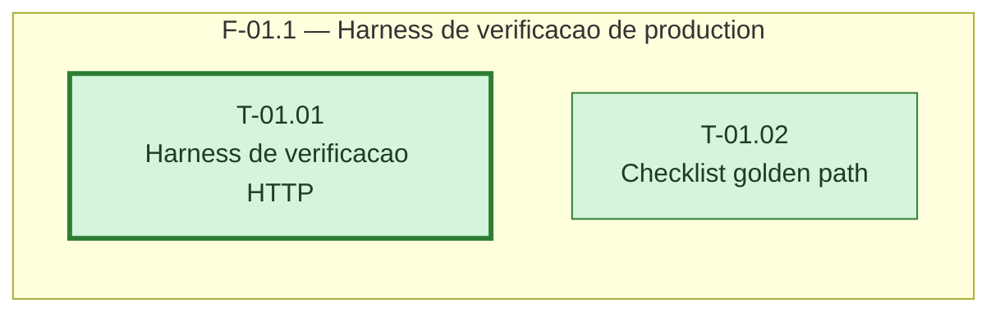

# Fases — Sprint 01

> Um bloco por fase. O paralelismo declarado aqui é definitivo: a execução nunca decide paralelismo sozinha.

---

## F-01.1 — Harness de verificação de production

**Objetivo:** Preparar o roteiro de verificação HTTP e o checklist manual do golden path, sem tocar em `production`.

**Tasks que a compõem:** T-01.01, T-01.02

**Critério de saída:** `VERIFICACAO.md` e `CHECKLIST-GOLDEN-PATH.md` existem com passos verificáveis.

**Roda em paralelo com:** nenhuma
