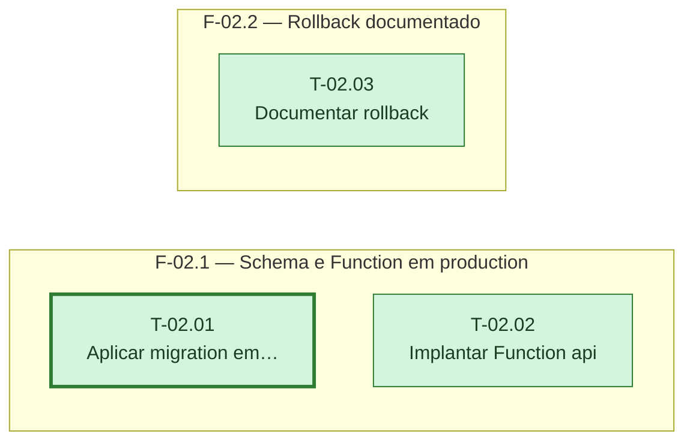

# Fases — Sprint 02

> Um bloco por fase. O paralelismo declarado aqui é definitivo: a execução nunca decide paralelismo sozinha.

---

## F-02.1 — Schema e Function em production

**Objetivo:** Aplicar a migration de negócio e implantar a Function `api` na branch `production`.

**Tasks que a compõem:** T-02.01, T-02.02

**Critério de saída:** Tabelas `lancamentos` e `caixinhas` existem e a Function `api` responde 200 em `/health`.

**Roda em paralelo com:** F-02.2

---

## F-02.2 — Rollback documentado

**Objetivo:** Registrar o procedimento de Instant Restore para a branch `production`.

**Tasks que a compõem:** T-02.03

**Critério de saída:** `ROLLBACK.md` existe com o procedimento referenciando a branch `production` real.

**Roda em paralelo com:** F-02.1
