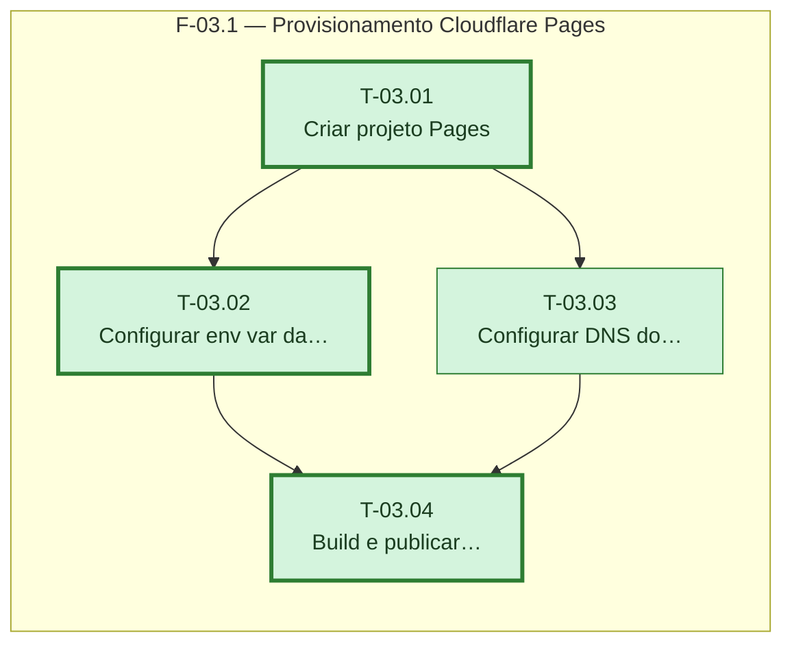

# Fases — Sprint 03

> Um bloco por fase. O paralelismo declarado aqui é definitivo: a execução nunca decide paralelismo sozinha.

---

## F-03.1 — Provisionamento Cloudflare Pages

**Objetivo:** Criar o projeto Pages, configurar env var e DNS, e publicar o build de produção.

**Tasks que a compõem:** T-03.01, T-03.02, T-03.03, T-03.04

**Critério de saída:** `https://contafacil.nymbuslab.com.br` responde 200 com o build atual do app.

**Roda em paralelo com:** nenhuma
