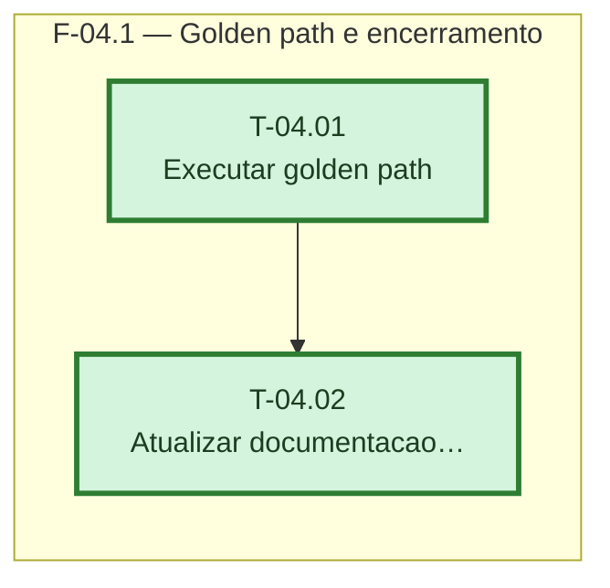

# Fases — Sprint 04

> Um bloco por fase. O paralelismo declarado aqui é definitivo: a execução nunca decide paralelismo sozinha.

---

## F-04.1 — Golden path e encerramento

**Objetivo:** Validar o fluxo completo em produção real e fechar a documentação viva.

**Tasks que a compõem:** T-04.01, T-04.02

**Critério de saída:** Checklist passa inteiro e a documentação viva reflete o rollout concluído.

**Roda em paralelo com:** nenhuma
