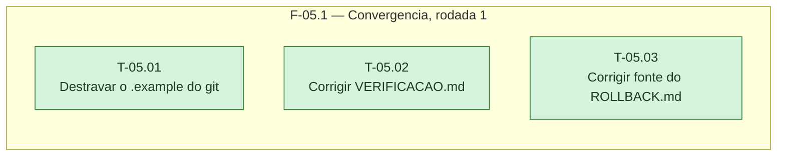

# Fases — Sprint 05

> Um bloco por fase. O paralelismo declarado aqui é definitivo: a execução nunca decide paralelismo sozinha.

---

## F-05.1 — Convergência, rodada 1

**Objetivo:** Corrigir os 3 achados ALTA/MÉDIA da conferência de convergência rodada 1.

**Tasks que a compõem:** T-05.01, T-05.02, T-05.03

**Critério de saída:** Os achados C-01, C-02 e C-03 de `00-CONVERGENCIA.md` deixam de ser verdade.

**Roda em paralelo com:** nenhuma
