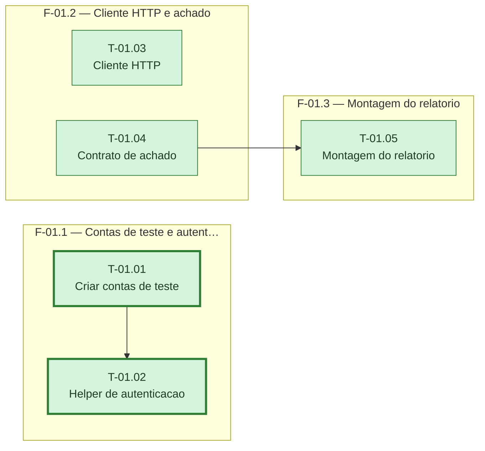

# Fases — Sprint 01

---

## F-01.1 — Contas de teste e autenticação ativa

**Objetivo:** Criar as duas contas reais de teste e o helper que devolve o JWT de cada uma.

**Tasks que a compõem:** T-01.01, T-01.02

**Critério de saída:** As duas contas existem na branch `test` e o helper autentica com sucesso contra as duas.

**Roda em paralelo com:** F-01.2, F-01.3

---

## F-01.2 — Cliente HTTP e contrato de achado

**Objetivo:** Expor o cliente HTTP comum e o formato de achado que todo checador vai devolver.

**Tasks que a compõem:** T-01.03, T-01.04

**Critério de saída:** Cliente HTTP e contrato de achado com suíte verde, sem dependência das contas de teste.

**Roda em paralelo com:** F-01.1

---

## F-01.3 — Montagem do relatório

**Objetivo:** Montar e gravar o relatório markdown a partir de uma lista de achados.

**Tasks que a compõem:** T-01.05

**Critério de saída:** Relatório gravado em `docs/seguranca/relatorios/AAAA-MM-DD.md` contém todos os achados recebidos.

**Roda em paralelo com:** F-01.1
