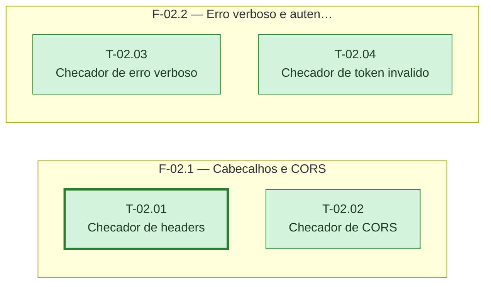

# Fases — Sprint 02

---

## F-02.1 — Cabeçalhos e CORS

**Objetivo:** Checar cabeçalhos de segurança ausentes e CORS aberto para origem não autorizada.

**Tasks que a compõem:** T-02.01, T-02.02

**Critério de saída:** Os dois checadores rodam contra produção real e devolvem achados no formato comum.

**Roda em paralelo com:** F-02.2

---

## F-02.2 — Erro verboso e autenticação passiva

**Objetivo:** Checar exposição de erro verboso e resposta consistente a token inválido.

**Tasks que a compõem:** T-02.03, T-02.04

**Critério de saída:** Os dois checadores rodam contra produção real e devolvem achados no formato comum.

**Roda em paralelo com:** F-02.1
