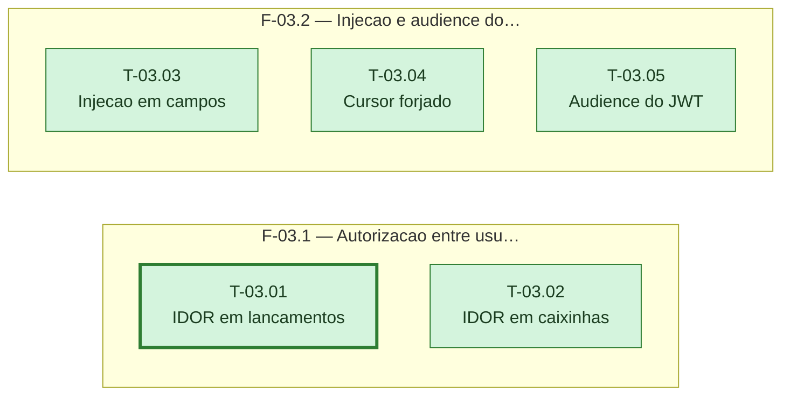

# Fases — Sprint 03

---

## F-03.1 — Autorização entre usuários (IDOR)

**Objetivo:** Confirmar que o usuário A nunca acessa recurso do usuário B em lançamentos e caixinhas.

**Tasks que a compõem:** T-03.01, T-03.02

**Critério de saída:** As duas checagens rodam contra a branch `test` real e confirmam 404 em toda tentativa cruzada.

**Roda em paralelo com:** F-03.2

---

## F-03.2 — Injeção e audience do JWT

**Objetivo:** Confirmar que payloads de injeção e cursores forjados nunca geram 500, e registrar se o JWT valida `audience`.

**Tasks que a compõem:** T-03.03, T-03.04, T-03.05

**Critério de saída:** As três checagens rodam contra a branch `test` real e devolvem achados no formato comum.

**Roda em paralelo com:** F-03.1
