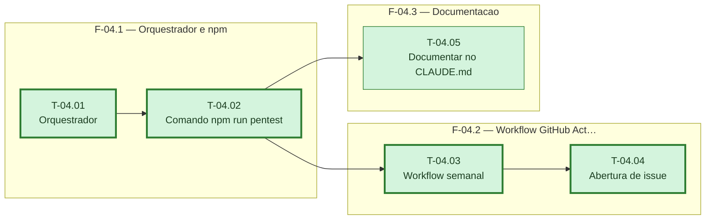

# Fases — Sprint 04

---

## F-04.1 — Orquestrador e comando npm

**Objetivo:** Rodar todos os checadores das sprints 02 e 03 e expor como `npm run pentest`.

**Tasks que a compõem:** T-04.01, T-04.02

**Critério de saída:** `npm run pentest` roda localmente e grava o relatório do dia em `docs/seguranca/relatorios/`.

**Roda em paralelo com:** nenhuma

---

## F-04.2 — Workflow do GitHub Actions

**Objetivo:** Agendar a execução semanal e abrir issue automaticamente em achado crítico.

**Tasks que a compõem:** T-04.03, T-04.04

**Critério de saída:** Workflow dispara manualmente com sucesso e o passo de issue só roda com achado `alta`.

**Roda em paralelo com:** F-04.3

---

## F-04.3 — Documentação

**Objetivo:** Documentar a rotina no `CLAUDE.md` do projeto.

**Tasks que a compõem:** T-04.05

**Critério de saída:** `CLAUDE.md` cita o comando, a pasta de relatórios e os nomes das env vars novas, sem valores.

**Roda em paralelo com:** F-04.2
