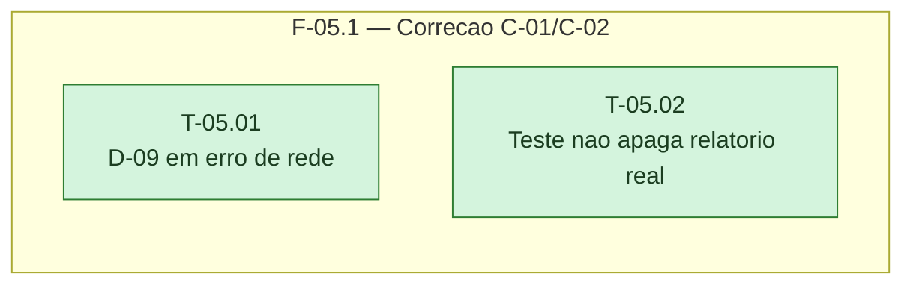

# Fases — Sprint 05

---

## F-05.1 — Correção dos achados C-01 e C-02

**Objetivo:** Fechar os dois achados MÉDIA da rodada 1 de convergência.

**Tasks que a compõem:** T-05.01, T-05.02

**Critério de saída:** suíte de `scripts/pentest/` verde; relatório real do dia sobrevive a
`npm run test`.
