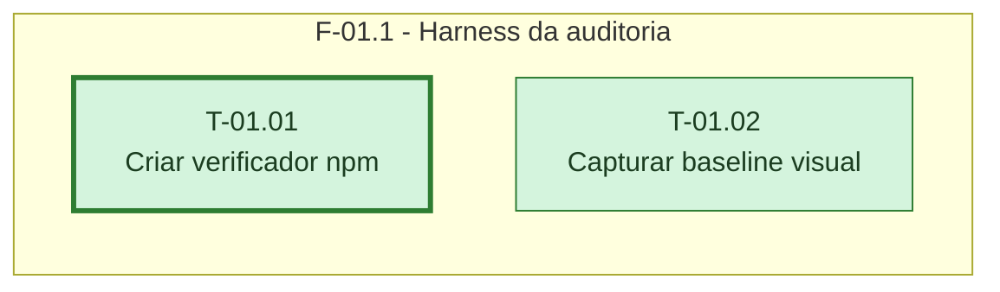

# Fases - Sprint 01

## F-01.1 - Harness da auditoria

**Objetivo:** Criar um comando testável que traduza o relatório do npm em um portão de segurança.

**Tasks que a compõem:** T-01.01, T-01.02

**Critério de saída:** O script cobre a matriz de auditoria e o baseline registra 16 estados v3 persistentes.

**Roda em paralelo com:** nenhuma
