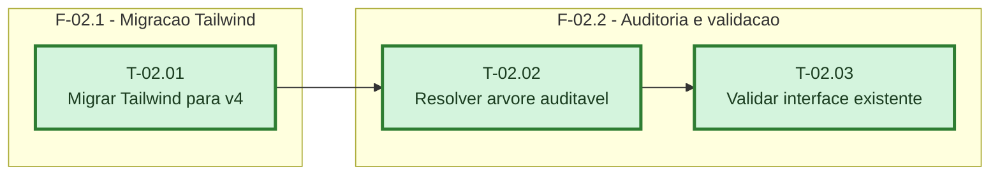

# Fases - Sprint 02

## F-02.1 - Migração Tailwind

**Objetivo:** Migrar configuração e tokens para a arquitetura CSS-first do Tailwind 4.

**Tasks que a compõem:** T-02.01

**Critério de saída:** A aplicação compila com Tailwind 4 e os tokens e animações atuais permanecem disponíveis.

**Roda em paralelo com:** nenhuma

## F-02.2 - Auditoria e validação

**Objetivo:** Resolver o que for compatível e validar a aplicação completa.

**Tasks que a compõem:** T-02.02, T-02.03

**Critério de saída:** O portão de auditoria, build, lint, testes e golden path visual passam.

**Roda em paralelo com:** nenhuma
