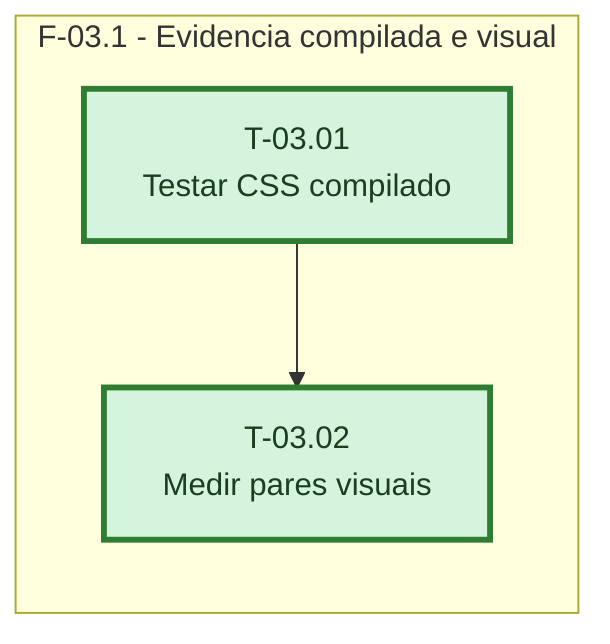

# Fases - Sprint 03

## F-03.1 - Evidência compilada e visual

**Objetivo:** substituir evidência nominal por verificações sobre o CSS final e por medições reproduzíveis da interface.

**Tasks que a compõem:** T-03.01, T-03.02

**Critério de saída:** teste do CSS final passa e os 16 pares possuem medidas e fingerprints equivalentes.

**Roda em paralelo com:** nenhuma
